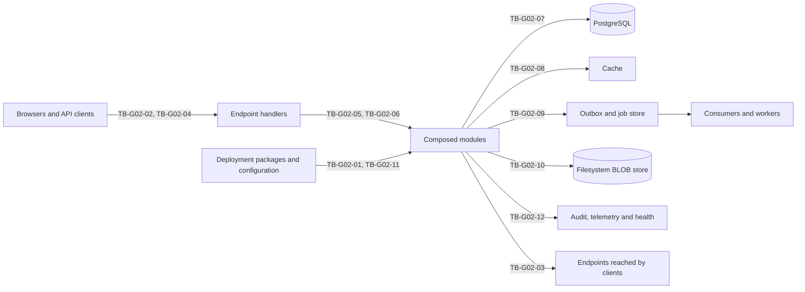

# G-02 foundation slice threat model

Model identifier: `g02-foundation`. Revision date: 2026-10-25. Profile: `reference`, with foundation controls reused by the `website` profile. This is an OPS-001 planning contract: it records required controls and planned evidence, not implemented or verified behavior. The [README](README.md) defines the method, classification scheme and conventions, and [controls.json](controls.json) holds the control map.

## Scope and assumptions

G-02 qualifies the secure foundation application of the [reference profile](../../profiles/reference.md): one small, ordinary .NET 10 application composed from foundation modules and exercised with real providers and failure cases. This model covers module composition, HTTP ingress, endpoint contracts and clients, identity and sessions, authorization, tenancy, persistence, caching, events and jobs, Files, configuration and secrets, and audit and diagnostics.

Its register scope is the G-02 entries, chiefly PRD-003, ARC-001 to ARC-003, ARC-005 to ARC-009, ARC-016, FND-001 to FND-031, FND-038, MOD-006, OPS-002, OPS-010, OPS-014 and DEV-004. The acceptance focus is the foundation families AC-001, AC-003, AC-004, AC-005, AC-006, AC-008 and AC-009, with AC-007 for scheduled execution. Some controls also trace to requirements that the register places at later gates, such as OPS-003, OPS-004, OPS-007, FND-037, MOD-026, MOD-028, OPS-009, OPS-018 and ARC-010, because the slice already depends on their behavior. Their complete evidence arrives at the gate the register assigns.

The model assumes:

1. **Deployment authority is trusted.** People who install packages and set deployment configuration act with application privileges, as ARC-014 and FND-005 describe for in-process code. The controls here catch unverified or inconsistent composition; they cannot stop a malicious deployer.
2. **Host and providers.** One host runs the application and its workers. PostgreSQL through EF Core holds module data and the outbox, inbox and job state; the filesystem BLOB provider holds Files content. The operator hardens and patches the operating system, container runtime, database server and storage, and restricts administrative access to them.
3. **Transport.** TLS terminates at the host or at a reverse proxy that the deployment declares. Traffic between that proxy and the host stays on a network segment the operator controls.
4. **Code trust.** Modules are trusted .NET code reviewed through the solution lifecycle. The slice runs no tenant-authored code, scripts or templates.
5. **Tenancy.** The shared-database profile applies, with tenant-scoped data, permissions, files, caches and background execution. Other placement profiles need their own models.
6. **Identity.** The slice exercises local account sign-in with server-side cookie sessions for its account actions, service identities for workers, and the session and claim-freshness contract of FND-017. External login, passkeys, recovery and the authorization server arrive at G-03 or later.
7. **Single node.** There is no distributed cache, broker or second node. Lease and stale-owner behavior is exercised through restarts and lease expiry on one host.
8. **Time.** The host clock is synchronized, and the runtime reads time through an injectable clock.

## Trust boundaries

| Boundary | Name | Less trusted side | More trusted side |
|---|---|---|---|
| TB-G02-01 | Module composition and activation | Packages, manifests and composition switches presented for deployment | The composed host after dependency, configuration and migration validation |
| TB-G02-02 | HTTP ingress | Browsers, API clients, proxies and the headers they send | Endpoint handlers after transport, host and input policies |
| TB-G02-03 | Endpoint contracts and clients | Callers of published endpoints, and remote endpoints reached by generated clients | The declared, versioned endpoint inventory and explicit client credential providers |
| TB-G02-04 | Identity and sessions | Presented credentials, cookies and service tokens | An authenticated principal with a known session and freshness |
| TB-G02-05 | Authorization | An authenticated principal's request | A permitted use case on a resolved resource |
| TB-G02-06 | Tenant context | Host names, routes, headers, claims and message fields that name a tenant | The validated execution context of one unit of work |
| TB-G02-07 | Persistence | Application queries, commands and migrations | PostgreSQL state owned by each module |
| TB-G02-08 | Caching | Values produced in one execution context | Entries served to later executions |
| TB-G02-09 | Events and jobs | Committed intent, queued work and delivered messages | Consumers and workers acting on that work |
| TB-G02-10 | Files and BLOB storage | Uploaded bytes, names and declared types, and download requests | Validated, owned file versions on the filesystem provider |
| TB-G02-11 | Configuration and secrets | Configuration files, environment values, secret references and settings changes | Validated options and secret values inside the host |
| TB-G02-12 | Audit and diagnostics | Security-relevant activity and telemetry produced by the application | Audit records, logs, traces, metrics and health responses read by operators |

## Assets and classification

| Asset | Classification | Integrity | Notes |
|---|---|---|---|
| Module packages, manifests and the deployment lock manifest | Internal | Critical | Determine which code and endpoints run |
| Migration history and schema version of each database | Internal | Critical | Gate readiness and recovery |
| Tenant directory, tenant domains and memberships | Restricted | Critical | The basis of tenant resolution |
| Account records and profile fields | Restricted | Standard | Personal data inventoried under OPS-006 |
| Password verifiers and other credential secrets | Secret | Critical | Never returned, logged or exported |
| Session identifiers, cookies and service tokens | Secret | Critical | Bearer authority until revoked or expired |
| Permission definitions, grants, role memberships and assignment ceilings | Restricted | Critical | A change alters authority |
| Settings and feature values without secrets | Confidential | Critical | Some values change security behavior |
| Secret settings, connection strings and provider credentials | Secret | Critical | Resolved from references only |
| Data-protection and signing key material | Secret | Critical | Protects cookies, tokens and encrypted values |
| Tenant business records in the slice's modules | Confidential | Standard | The data that cross-tenant tests try to reach |
| Outbox, inbox and job records with their payloads | Confidential | Critical | Carry committed intent and tenant context |
| Cache entries | Confidential | Standard | Inherit the classification of their sources |
| File content and metadata awaiting or past validation | Confidential | Standard | Untrusted until validation completes |
| Files approved for anonymous delivery | Public | Critical | Public only by explicit policy |
| Download grants and signed access values | Secret | Critical | Bound to tenant, version, purpose and expiry |
| Audit records | Restricted | Critical | Attribute privileged activity |
| Logs, traces and metrics | Internal | Standard | Must exclude secrets and minimize personal data |
| Endpoint inventory and generated contract documents | Internal | Critical | Define what is remotely callable |
| Correlation identifiers | Internal | Standard | Diagnostic linkage only, never authority |

## Privileged operations

| Operation | Authority required | Controls |
|---|---|---|
| Install, activate, disable or upgrade a module | Deployment authority, applied through a controlled deployment and restart | TM-G02-001, TM-G02-002, TM-G02-003 |
| Apply migrations or run required seed contributors | Deployment authority while holding the migration lock | TM-G02-032 |
| Bypass a tenant or soft-delete filter | An explicit, scoped privilege on a reviewed code path, recorded in audit | TM-G02-029, TM-G02-051 |
| Grant or revoke permissions, roles and resource shares | Permission administration within the grantor's assignment ceiling | TM-G02-022, TM-G02-051 |
| Run a host operation that spans tenants | Separately granted host authority under an elevated policy | TM-G02-028, TM-G02-051 |
| Impersonate a subject or act under delegation | A delegation grant with scope, purpose and expiry | TM-G02-018, TM-G02-051 |
| Revoke sessions | The account owner, or identity administration for other accounts | TM-G02-017 |
| Change settings, features or secret settings | Configuration authority for the setting's scope | TM-G02-024, TM-G02-047, TM-G02-049 |
| Retry, quarantine or replay failed events and jobs | Operator permission for the owning module, recorded as a replay | TM-G02-037 |
| Issue or revoke file share grants | Sharing permission on the file | TM-G02-044 |
| Rotate data-protection keys and provider secrets | Security operations authority | TM-G02-050 |
| Read audit records or detailed diagnostics | Audit read or diagnostics permission, separate from audit administration | TM-G02-052, TM-G02-054 |

## External inputs

| Input | Source | Boundary | Controls |
|---|---|---|---|
| Host, forwarded and proxy headers | Clients and proxies | TB-G02-02 | TM-G02-006 |
| Cookies, antiforgery values and bearer credentials | Browsers and API clients | TB-G02-04 | TM-G02-007, TM-G02-016 |
| Route values, query parameters and JSON or form bodies | Clients | TB-G02-02 | TM-G02-008, TM-G02-009 |
| Paging, sorting and filter parameters | Clients | TB-G02-07 | TM-G02-009, TM-G02-029 |
| Sign-in credentials | Interactive users | TB-G02-04 | TM-G02-015 |
| Tenant candidates in host names, routes, headers and claims | Clients and the identity provider | TB-G02-06 | TM-G02-025 |
| Event messages and job arguments at execution time | The outbox dispatcher and job store | TB-G02-09 | TM-G02-027, TM-G02-036, TM-G02-041 |
| Uploaded bytes, file names, declared types and range requests | Clients | TB-G02-10 | TM-G02-042, TM-G02-043, TM-G02-045 |
| Module packages and manifests | The deployment pipeline | TB-G02-01 | TM-G02-001 |
| Configuration files, environment values and secret references | The deployment | TB-G02-11 | TM-G02-047, TM-G02-048 |
| Discovery data and redirects received by clients | Remote endpoints | TB-G02-03 | TM-G02-013 |
| Correlation and trace headers | Clients | TB-G02-12 | TM-G02-053 |
| Clock readings and time-zone data | The host | TB-G02-09 | TM-G02-040 |

## Threats

### TB-G02-01 — Module composition and activation

| Threat | Category | Description | Controls |
|---|---|---|---|
| TH-G02-001 | Tampering | A module package or manifest differs from the reviewed release, for example through a substituted file or a widened dependency range, and the host composes it. | TM-G02-001 |
| TH-G02-002 | Elevation of privilege | A module is activated before its migrations, required configuration or permission definitions are in place, so its endpoints and handlers run without the policies they assume. | TM-G02-002 |
| TH-G02-003 | Denial of service | An initializer fails or a dependency is missing, yet the host reports readiness and serves a partly composed application. | TM-G02-003 |
| TH-G02-004 | Tampering | One module writes another module's tables directly in the shared database, bypassing that module's invariants and authorization. | TM-G02-004 |
| TH-G02-005 | Information disclosure | An extension property becomes readable, writable or searchable through APIs merely because it exists. | TM-G02-005 |

### TB-G02-02 — HTTP ingress

| Threat | Category | Description | Controls |
|---|---|---|---|
| TH-G02-006 | Spoofing | Forged host or forwarded headers change the scheme, host, client address or tenant candidate that the application resolves. | TM-G02-006 |
| TH-G02-007 | Tampering | A cross-site request causes a state change through a cookie-authenticated session. | TM-G02-007 |
| TH-G02-008 | Spoofing | A return-address or redirect parameter sends a user to an external origin after sign-in or another action. | TM-G02-006 |
| TH-G02-009 | Tampering | A request sets fields the operation does not accept, such as owner, tenant, version or a protected extension property. | TM-G02-008 |
| TH-G02-010 | Denial of service | Oversized bodies, deeply nested documents, slow requests or unbounded paging and sorting exhaust the single host. | TM-G02-009 |
| TH-G02-011 | Information disclosure | Error responses reveal stack traces, queries, configuration, internal topology or the existence of resources the caller cannot read. | TM-G02-010 |
| TH-G02-012 | Tampering | Client-supplied filter or sort input is translated into an executable query, or a value is concatenated into direct SQL. | TM-G02-009, TM-G02-029 |

### TB-G02-03 — Endpoint contracts and clients

| Threat | Category | Description | Controls |
|---|---|---|---|
| TH-G02-013 | Elevation of privilege | An application service becomes remotely callable because it is registered, without a declared route, version and policy. | TM-G02-011 |
| TH-G02-014 | Elevation of privilege | An endpoint is anonymous by omission rather than by explicit declaration. | TM-G02-011, TM-G02-019 |
| TH-G02-015 | Tampering | A contract change silently alters the meaning of a field, such as visibility or an access flag, for clients built against an earlier version. | TM-G02-012 |
| TH-G02-016 | Information disclosure | A generated or dynamic client forwards ambient credentials to an endpoint chosen by discovery data or a redirect, or writes tokens into its diagnostics. | TM-G02-013 |
| TH-G02-017 | Information disclosure | The bootstrap configuration response includes settings, features or permissions not approved for the requesting principal and tenant, or a cached copy built for another principal. | TM-G02-014 |

### TB-G02-04 — Identity and sessions

| Threat | Category | Description | Controls |
|---|---|---|---|
| TH-G02-018 | Spoofing | Automated password guessing or credential stuffing targets sign-in, and response differences reveal which accounts exist. | TM-G02-015 |
| TH-G02-019 | Spoofing | A session identifier is fixed before sign-in, or a stolen session cookie is replayed. | TM-G02-016 |
| TH-G02-020 | Elevation of privilege | Claims or permissions held by an issued session remain effective after a role change, permission removal or revocation. | TM-G02-017 |
| TH-G02-021 | Repudiation | Impersonation or delegation records only the effective subject, so the real actor cannot be identified. | TM-G02-018 |
| TH-G02-022 | Elevation of privilege | Background work reuses a captured user credential or an administrator identity to do what its own service identity may not. | TM-G02-018, TM-G02-041 |

### TB-G02-05 — Authorization

| Threat | Category | Description | Controls |
|---|---|---|---|
| TH-G02-023 | Elevation of privilege | A use case, scheduled job or integration endpoint omits a policy that its interactive counterpart enforces, or relies on UI visibility. | TM-G02-019 |
| TH-G02-024 | Elevation of privilege | A caller supplies the identifier of another owner's resource in the same tenant, and the operation proceeds. | TM-G02-020 |
| TH-G02-025 | Information disclosure | Lists, totals, previews or exports include resources the caller cannot read. | TM-G02-021 |
| TH-G02-026 | Elevation of privilege | An administrator grants a permission beyond their assignment ceiling, or concurrent grant changes evade the ceiling. | TM-G02-022 |
| TH-G02-027 | Elevation of privilege | An authorization check depends on an interceptor that a particular invocation path never reaches. | TM-G02-023 |
| TH-G02-028 | Elevation of privilege | A feature entitlement or setting is treated as authority, or a permission grant reaches a capability that the composition excludes. | TM-G02-024 |

### TB-G02-06 — Tenant context

| Threat | Category | Description | Controls |
|---|---|---|---|
| TH-G02-029 | Spoofing | A host name, route value, header or token claim names another tenant, and the request runs in that tenant without membership. | TM-G02-025 |
| TH-G02-030 | Information disclosure | Tenant or actor state from one execution survives into the next on a reused worker, pooled context or asynchronous continuation. | TM-G02-026 |
| TH-G02-031 | Elevation of privilege | A consumer or job acts for the tenant named in its payload without revalidating the producer's authority. | TM-G02-027, TM-G02-041 |
| TH-G02-032 | Elevation of privilege | A tenant administrator reaches a host operation, or host scope is applied to a request implicitly. | TM-G02-028 |

### TB-G02-07 — Persistence

| Threat | Category | Description | Controls |
|---|---|---|---|
| TH-G02-033 | Information disclosure | A query path omits the tenant or soft-delete predicate, such as direct SQL, a projection, a bulk operation or an unfiltered navigation. | TM-G02-029 |
| TH-G02-034 | Tampering | Concurrent writers overwrite each other because a write omits or ignores the version token. | TM-G02-030 |
| TH-G02-035 | Tampering | A unit of work spans more than the provider's actual transaction, or performs an external effect inside it, leaving partial state after a failure. | TM-G02-031 |
| TH-G02-036 | Denial of service | An interrupted or concurrent migration leaves the schema partly applied while the application accepts traffic. | TM-G02-032 |
| TH-G02-037 | Information disclosure | Demonstration seed data or development credentials reach a production database. | TM-G02-032, TM-G02-048 |
| TH-G02-038 | Information disclosure | A uniqueness constraint or index omits the tenant, so one tenant can detect or block another tenant's keys. | TM-G02-029 |

### TB-G02-08 — Caching

| Threat | Category | Description | Controls |
|---|---|---|---|
| TH-G02-039 | Information disclosure | A cache key omits the tenant, principal, module or schema dimension, so one context receives an entry built for another. | TM-G02-033 |
| TH-G02-040 | Elevation of privilege | A cached authorization or permission result outlives the revocation that should end it. | TM-G02-017, TM-G02-033 |
| TH-G02-041 | Denial of service | Cache unavailability or a stampede on expiry overloads the database. | TM-G02-034 |

### TB-G02-09 — Events and jobs

| Threat | Category | Description | Controls |
|---|---|---|---|
| TH-G02-042 | Tampering | A crash between commit and dispatch loses an event, or an event is dispatched for a change that rolled back. | TM-G02-035 |
| TH-G02-043 | Tampering | Duplicate, late or reordered delivery repeats a side effect or applies an older state over a newer one. | TM-G02-036 |
| TH-G02-044 | Denial of service | A poison message or job retries without bound and delays other work. | TM-G02-037 |
| TH-G02-045 | Repudiation | A replay of dead-lettered work cannot be told apart from a new business action, or runs under the replaying operator's authority. | TM-G02-037 |
| TH-G02-046 | Tampering | A worker whose lease has expired keeps acting and duplicates exclusive work. | TM-G02-038 |
| TH-G02-047 | Information disclosure | Event bodies or job arguments carry secrets, access tokens or unnecessary personal data that persist in history and dead letters. | TM-G02-039 |
| TH-G02-048 | Tampering | A schedule fires twice, early or not at all across restarts, misfires or daylight-saving transitions. | TM-G02-040 |

### TB-G02-10 — Files and BLOB storage

| Threat | Category | Description | Controls |
|---|---|---|---|
| TH-G02-049 | Tampering | Uploaded bytes with a misleading name, extension or declared type become readable before validation and scanning finish. | TM-G02-042 |
| TH-G02-050 | Tampering | A file name or logical path escapes the storage root of the filesystem provider. | TM-G02-043 |
| TH-G02-051 | Information disclosure | A caller downloads a file by guessing its location or identifier, or uses a grant issued before access was revoked. | TM-G02-044 |
| TH-G02-052 | Information disclosure | A browser interprets a downloaded file as active content in the application's origin. | TM-G02-044 |
| TH-G02-053 | Denial of service | Oversized uploads, concurrent quota consumption or abandoned upload sessions exhaust storage. | TM-G02-045 |
| TH-G02-054 | Tampering | An interrupted write leaves metadata pointing at partial or different bytes, and the mismatch goes unnoticed until delivery or restore. | TM-G02-046 |

### TB-G02-11 — Configuration and secrets

| Threat | Category | Description | Controls |
|---|---|---|---|
| TH-G02-055 | Information disclosure | A secret appears in source control, a package, a settings response, a diagnostic page or telemetry. | TM-G02-047 |
| TH-G02-056 | Tampering | Invalid or incompatible configuration is accepted at startup or reload and silently weakens a control. | TM-G02-048 |
| TH-G02-057 | Elevation of privilege | A tenant setting overrides a deployment security option that was never declared tenant-configurable. | TM-G02-049 |
| TH-G02-058 | Information disclosure | Data-protection keys are shared beyond the application boundary, lost on redeployment, or exposed through backups. | TM-G02-050 |

### TB-G02-12 — Audit and diagnostics

| Threat | Category | Description | Controls |
|---|---|---|---|
| TH-G02-059 | Repudiation | A privileged change commits without durable audit evidence, or an audit failure is ignored. | TM-G02-051 |
| TH-G02-060 | Tampering | Ordinary administrators alter or purge audit records, or tamper evidence is claimed without a qualified mechanism. | TM-G02-052 |
| TH-G02-061 | Information disclosure | Logs, traces or metrics capture secrets, tokens, request bodies or personal data, or expose tenant names through labels. | TM-G02-053 |
| TH-G02-062 | Information disclosure | Health or readiness responses reveal dependency details, versions or topology to anonymous callers. | TM-G02-054 |
| TH-G02-063 | Spoofing | A client-supplied correlation identifier is trusted as authority or used to join unrelated traces. | TM-G02-053 |

## Abuse cases

| Threat | Category | Description | Controls |
|---|---|---|---|
| TH-G02-064 | Abuse case | A member of one tenant iterates identifiers across records, files and job status to read another tenant's data. | TM-G02-020, TM-G02-025, TM-G02-029, TM-G02-044 |
| TH-G02-065 | Abuse case | An administrator removed from a role keeps an open session and a cached grant long enough to export data. | TM-G02-017, TM-G02-021, TM-G02-033 |
| TH-G02-066 | Abuse case | A user uploads active content disguised as an image and circulates its download link. | TM-G02-042, TM-G02-044 |
| TH-G02-067 | Abuse case | An operator replays dead-lettered work hoping to repeat an external effect or to act with elevated authority. | TM-G02-036, TM-G02-037 |
| TH-G02-068 | Abuse case | A tenant administrator adds another tenant's identifier or a host-scope marker to a request to run a host operation. | TM-G02-025, TM-G02-028 |
| TH-G02-069 | Abuse case | Someone with access to the deployment pipeline swaps a module package to add an unauthenticated endpoint. | TM-G02-001, TM-G02-011 |
| TH-G02-070 | Abuse case | One tenant floods expensive list requests and large uploads to starve other tenants on the shared host. | TM-G02-009, TM-G02-045 |
| TH-G02-071 | Abuse case | A support request asks for a diagnostic bundle that would carry session cookies and connection strings off the host. | TM-G02-047, TM-G02-053 |

## Controls

Owners, boundaries, requirements, evidence and profiles for each control are in [controls.json](controls.json).

| Control | Owner | Required behavior |
|---|---|---|
| TM-G02-001 | Framework composition | Resolve the complete module graph from manifests before activation; reject missing, cyclic, incompatible or untrusted selections with actionable diagnostics; and require the deployment lock manifest to record and match the exact resolved package versions and content hashes. |
| TM-G02-002 | Framework composition | Treat installation, migration and activation as separate operations. Activate a module only when its migrations are complete, its required configuration validates and its permissions and endpoints are declared; disabling it lists dependent modules, running work and the data it keeps. |
| TM-G02-003 | Framework composition | Run the documented lifecycle order. Any validation, initialization or migration-readiness failure keeps the host unready and names the module and stage; shutdown stops new work, drains or checkpoints it within a deadline and releases owned resources. |
| TM-G02-004 | Framework composition | Architecture checks reject references to another module's persistence model, and migrations create objects only in the owning module's schema. Other modules use public services or versioned events. |
| TM-G02-005 | Framework composition | Extension properties declare type, validation, sensitivity, permissions and serialization policy, and APIs expose, accept or index a property only where its declaration allows. |
| TM-G02-006 | API | Accept forwarded headers only from configured proxies, accept only configured host names, take the public origin from configuration, and allow redirects only to relative paths or configured origins. |
| TM-G02-007 | API | Require a valid antiforgery token on every cookie-authenticated state-changing request, issue session cookies with SameSite protection, and never change state on safe methods. |
| TM-G02-008 | API | Bind requests to operation-specific input contracts that list the writable fields, derive owner, tenant and audit fields on the server, and validate DTO, domain and resource rules on the server. |
| TM-G02-009 | API | Enforce body-size, nesting-depth, field-length and request-time limits before full deserialization; accept paging, sorting and filtering only on declared fields with bounded page sizes; and never compile client input into query expressions. |
| TM-G02-010 | API | Return public errors as stable codes with a correlation identifier, keep stack traces, queries, configuration and topology in protected diagnostics, and answer conflicts and denials without revealing unauthorized data. |
| TM-G02-011 | API | Expose only services declared in a versioned endpoint inventory with route, method, version and policy. Startup rejects an endpoint that has neither a policy nor an explicit anonymous declaration, and contract tests compare the inventory with declared permissions. |
| TM-G02-012 | API | Generate contract documents reproducibly, compare them with the previous release, and block a breaking or meaning-changing change unless it carries a new version and a consumer migration plan. |
| TM-G02-013 | API | Generated and dynamic clients use explicit credential providers bound to configured endpoint origins, never forward ambient credentials to discovered or redirected endpoints, and redact tokens from their diagnostics. |
| TM-G02-014 | Capabilities | Bootstrap configuration returns only values marked client-visible for the requesting principal and tenant, and its cache varies by every dimension that affects the result. |
| TM-G02-015 | Identity | Limit sign-in attempts per account and per source through operation limits that apply at every entry point, delay or lock out according to policy, and return the same response for unknown accounts and wrong credentials. |
| TM-G02-016 | Identity | Issue a new session identifier at authentication, set Secure, HttpOnly, host-only and SameSite cookie attributes, keep a server-side session record, and apply idle and absolute expiry. |
| TM-G02-017 | Identity | Declare a freshness bound for claims, permissions and sessions; recheck security-sensitive operations against the current permission and session version; and end revoked sessions within that bound. |
| TM-G02-018 | Identity | Record actor, effective subject and identity kind in the execution context; give each delegation a scope, purpose, expiry and revocation; and run background work under its own scoped service identity rather than an administrator's. |
| TM-G02-019 | Authorization | Check stable permission identifiers in server use cases for interactive, scheduled and integration entry points alike, deny by default, and treat UI visibility as presentation only. |
| TM-G02-020 | Authorization | Resolve the resource within the effective tenant, then check ownership and resource grants for the requested operation before any read or change. |
| TM-G02-021 | Authorization | Apply authorization while building list results, counts, previews and exports, so that hidden resources influence neither totals nor content. |
| TM-G02-022 | Authorization | Check each permission grant against the grantor's assignment ceiling inside the same transaction as the change, so that concurrent changes cannot exceed it. |
| TM-G02-023 | Framework composition | Run authorization, validation, auditing and transactions in a documented order at explicit entry points; report at startup any invocation path the behavior pipeline cannot intercept; and test that no protected path relies on interception alone. |
| TM-G02-024 | Capabilities | Evaluate permissions, feature entitlements, settings and composition features as separate systems. A feature or setting never grants authority, and an excluded module's endpoints are absent rather than hidden. |
| TM-G02-025 | Tenancy | Treat host names, routes, headers and claims as tenant candidates, and establish the effective tenant only after checking membership or host authority, the configured domains and the operation being requested. |
| TM-G02-026 | Tenancy | Give every request, job and message its own newly created scoped context, disposed when the work ends, and test that a reused worker carries no tenant or actor state into its next unit of work. |
| TM-G02-027 | Tenancy | Carry the validated tenant and actor into events and jobs explicitly; the receiver revalidates them and the producer's authority before acting, and a tenant identifier alone never authorizes work. |
| TM-G02-028 | Tenancy | Require separately granted host authority and an elevated policy for cross-tenant operations, record them in audit, and test tenant-administrator attempts to reach host paths. |
| TM-G02-029 | Persistence | Apply tenant and soft-delete predicates on every supported access path, include the tenant in uniqueness constraints and indexes, parameterize direct SQL and declare how it preserves the same predicates, and make any bypass explicit, scoped and audited. |
| TM-G02-030 | Persistence | Require a version token for writes to concurrency-controlled resources, and reject a stale token with a conflict that preserves the caller's values and discloses nothing unauthorized. |
| TM-G02-031 | Persistence | Bound each unit of work to one PostgreSQL transaction, report committed, rolled-back and failed outcomes distinctly, and record external effects as durable intent instead of performing them inside the transaction. |
| TM-G02-032 | Persistence | Run migrations under a lock with preflight checks and per-database progress, resume after interruption, keep the application unready until the schema matches, and keep demonstration seeds out of production composition. |
| TM-G02-033 | Caching | Build cache keys from tenant, module and schema version, and from the principal or authorization scope for authorization-sensitive entries; give those entries a declared staleness limit; and invalidate them on grant, capability and setting changes. |
| TM-G02-034 | Caching | Declare and test the behavior during cache outages, protect expensive entries against stampedes, and never treat a local fallback as cross-process coordination. |
| TM-G02-035 | Events | Write integration events to the outbox in the same PostgreSQL transaction as the state change, and dispatch them with retries that survive crashes on either side of the commit. |
| TM-G02-036 | Events | Record processed event identities in an inbox for a declared retention window, use idempotency keys for external effects, and apply per-subject version ordering so that late events cannot overwrite newer state. |
| TM-G02-037 | Events | Bound retries with backoff, quarantine poison messages and jobs, expose lag and failures to operators, and record each replay as a replay with its original provenance and authorization. |
| TM-G02-038 | Jobs | Grant exclusive work through expiring leases that report renewal and loss, and fence writes with a token or version so that a stale owner's writes are rejected. |
| TM-G02-039 | Events | Events and jobs carry references and a privacy classification rather than secrets, tokens or unnecessary personal data, and job history and dead-letter views show redacted arguments. |
| TM-G02-040 | Jobs | Persist schedule instants in UTC with the intended time zone and a declared misfire policy, read time through an injectable clock, and make each occurrence idempotent. |
| TM-G02-041 | Jobs | Jobs capture validated tenant and actor references, never request objects or reusable user credentials, and run under the service identity their declaration names. |
| TM-G02-042 | Files | Store uploads in quarantine, detect type from content rather than from the name or declared type, scan according to policy, and make a version readable only after validation passes. A failed or unavailable scan keeps the version quarantined. |
| TM-G02-043 | Files | Address stored content by server-issued logical identities, treat supplied names as metadata, and resolve every storage location inside the provider root without following links. |
| TM-G02-044 | Files | Serve restricted files only through a gateway that checks current authorization for the tenant, object version and purpose; bind grants to an expiry and revoke them individually; and send explicit content types with sniffing disabled and attachment disposition unless the type is approved for inline display. |
| TM-G02-045 | Files | Enforce size limits while streaming, reserve quota atomically before accepting bytes, expire abandoned upload sessions, and reconcile orphaned objects. |
| TM-G02-046 | Files | Compute content hashes while writing, finalize metadata only when hash and length match, and verify hashes again during restore and before delivering restored content. |
| TM-G02-047 | Configuration | Resolve secrets only from references to an authorized store; keep them out of source, packages, settings responses, diagnostics and telemetry; mask secret settings and accept only replacement; and scan the repository and release artifacts for secrets. |
| TM-G02-048 | Configuration | Validate typed options and provider compatibility at startup and before any reload takes effect, and keep the host unready while validation fails. |
| TM-G02-049 | Configuration | Keep deployment options, application settings and tenant settings in separate contracts with documented precedence, and let a tenant change only settings declared tenant-configurable. |
| TM-G02-050 | Security | Persist the data-protection key ring in a protected location scoped to this application, back it up separately from data exports under restricted access, and document its rotation and revocation. |
| TM-G02-051 | Audit | Write audit intent for privileged and security changes in the same transaction as the change, or refuse or defer the change when the record cannot be written. Records name the actor, effective subject, tenant, resource, action, outcome, time and correlation. |
| TM-G02-052 | Audit | Separate audit writing from audit reading and administration, deny ordinary administrators any change to records, and make no tamper-evidence claim until a qualified mechanism exists. |
| TM-G02-053 | Operations | Emit structured telemetry from allowlisted fields; redact secrets, tokens, request bodies and personal data; keep tenant labels out of metric dimensions; and treat inbound correlation values as bounded, untrusted text that never conveys authority. |
| TM-G02-054 | Operations | Separate liveness from readiness, return minimal responses to anonymous probes, and require operator authorization for dependency, version and topology detail. |

## Residual risks and out of scope

### Residual risks

These risks remain when every control above works as specified. Each needs explicit acceptance at the G-02 qualification review.

- **Trusted deployers.** Someone who can change packages or deployment configuration can defeat in-process controls (TH-G02-001, TH-G02-069). TM-G02-001 detects drift from the reviewed release, but the protection ultimately depends on access control for the pipeline and host, plus the provenance and SBOM evidence that OPS-009 and DEV-018 require at G-08.
- **Shared capacity.** G-02 has no per-tenant quotas; OPS-018 resource governance arrives at G-08. Request bounds and quota reservation (TM-G02-009, TM-G02-045) limit single requests, but one tenant can still degrade others on the shared host (TH-G02-070).
- **Freshness window.** Within the declared freshness bound of TM-G02-017, a revoked grant or session can still act (TH-G02-020, TH-G02-040). The bound must be short enough for the slice's operations and is reported with its evidence.
- **Scanner limits.** Content detection and scanning recognize known patterns; novel malicious content can pass (TH-G02-049). Quarantine and inline-display restrictions reduce exposure without guaranteeing safety.
- **Audit integrity.** Ordinary database rows provide no tamper evidence (TH-G02-060). Database administrators can alter audit and business data; no tamper-evident claim is made.
- **Data at rest.** Unless the release enables content encryption under FND-031 and records its key handling, the slice relies on host and database access controls for data at rest, and a host or database compromise exposes Confidential and Restricted data.
- **Already delivered data.** Revocation stops new access through the gateway (TM-G02-044) but cannot recall files or responses that were already delivered.

### Out of scope

- Email, SMS and templates (FND-032, FND-033), the canonical Admin, external login, passkeys, account recovery and the authorization server; these qualify at G-03 or later.
- CMS, publication and the website surfaces, modeled in the [website profile model](website-profile.md), and AI, low-code and payment modules.
- Database-per-tenant and hybrid placement, other relational or document providers, cloud or object BLOB stores, distributed caches and brokers, multiple nodes, Kubernetes and separate services.
- Compromise of the operating system, container runtime, database server or administrator workstations, and physical or social-engineering attacks on operators.
- The release security review, dependency and license review, and the ASVS applicability assessment, which produce their own evidence.
