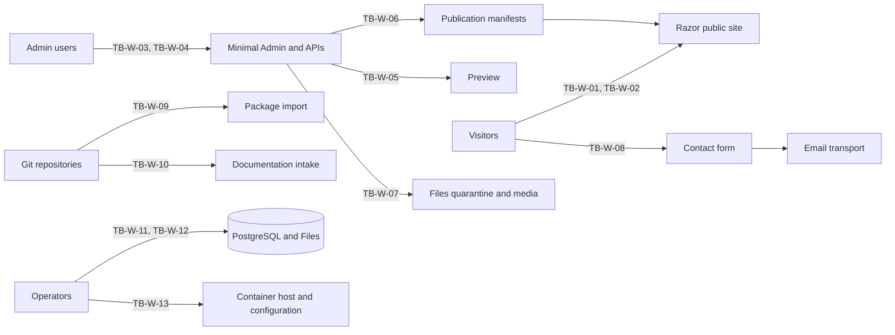

# Website profile threat model

Model identifier: `website-profile`. Revision date: 2026-10-25. Profile: `website`, at gate W. This is an OPS-001 planning contract: it records required controls and planned evidence, not implemented or verified behavior. The [README](README.md) defines the method, classification scheme and conventions, and [controls.json](controls.json) holds the control map.

## Scope and assumptions

The [website profile](../../profiles/website.md) serves a product site with versioned documentation, a personal site with a blog, or a small business site. Its tuple is .NET 10 and C# 14 in a modular monolith, PostgreSQL through EF Core, a Razor public site with a minimal React and TypeScript Admin subset, one tenant with one site and one culture, alias domains and redirects, a single-host container deployment, filesystem BLOB storage through Files, and a deployment-configured email transport for contact requests.

This model covers the included capabilities of the [capability map](../../profiles/website-capabilities.json) through these surfaces: the public Razor site; the minimal Admin and its sign-in with two-factor authentication or passkeys, recovery and session revocation; preview, publication, scheduling and rollback; media upload and quarantine; the contact form and its email; content-package dry run and apply; documentation intake from pinned Git sources; alias domains and host validation; backup and restore; upgrade; and the container host and its deployment configuration. The profile's security capability calls for ASVS Level 2 controls on the public, Admin, API, preview, import and contact surfaces (OPS-001, OPS-002, OPS-005). This model identifies the controls those surfaces need; the applicability assessment itself is evidence planned under AC-031.

W qualifies an early subset of the complete CMS contracts. Its register entries remain at their own gates; requirements cited here, such as CMS-005, CMS-021, MOD-001 or MOD-011, are cited for the W subset that the capability map describes, not for the whole contract.

The model assumes:

1. **Foundation controls apply.** The [G-02 foundation model](g02-foundation.md) applies on W's tuple. Its controls that name the `website` profile are reused here and cited where W adds exposure; they are not repeated.
2. **One tenant and one site.** The deployment has exactly one tenant, one site and one culture. Tenant and site boundaries still apply, and forged identifiers must fail as they would with many tenants.
3. **Canonical origin.** The deployment configures one canonical public origin. The minimal Admin, preview and APIs are served under reserved namespaces on that origin. Alias domains belong to the same site and carry public routes only.
4. **Transport.** TLS terminates at the container or at a reverse proxy that the deployment declares, and certificates for the canonical and alias domains are provisioned by the deployment.
5. **Installed code only.** The Razor renderer, its layouts, templates and blocks, and the original theme are installed, reviewed code. Neither authors nor packages can supply scripts, styles or executable templates.
6. **Admin session.** The minimal Admin is a browser application served by the deployment that calls the server through a cookie session, following the backend-for-frontend recommendation of OPS-003.
7. **Every Admin user is privileged.** The Admin has few users, and each one can change public content. All of them are protected as privileged accounts.
8. **Untrusted packages and sources.** Content packages and documentation sources are untrusted input even when they come from the site owner's own repository.
9. **Content-package rules.** The format's forbidden-content rules are being revised separately. This model relies on them only through what they accomplish, and it is revised if their effect changes.
10. **Scanning and email.** The deployment provides a malware-scanning integration for Files and an email transport. Their accuracy and delivery guarantees belong to those providers; the product owns how it reacts to their results.
11. **Backups.** Backups are written to storage outside the container under a documented procedure run by a recovery role.

## Trust boundaries

| Boundary | Name | Less trusted side | More trusted side |
|---|---|---|---|
| TB-W-01 | Public site delivery | Anonymous visitors and crawlers | The Razor site serving the active publication manifest |
| TB-W-02 | Host and alias-domain resolution | Host headers, server names and DNS state for configured domains | The canonical site after host validation and verified alias binding |
| TB-W-03 | Admin sign-in and sessions | Credentials, second factors, passkey assertions and recovery proofs | An Admin session bound to a verified account |
| TB-W-04 | Admin actions and APIs | Requests from the minimal Admin or any client holding an Admin session | Authorized server operations on the site |
| TB-W-05 | Preview | A preview request for a selected revision | A protected rendering of exactly that revision |
| TB-W-06 | Publication, scheduling and rollback | Publish, schedule, withdraw and rollback requests, and scheduler triggers | The active immutable publication manifest |
| TB-W-07 | Media upload and quarantine | Uploaded bytes, names and declared types | Validated media versions eligible for publication |
| TB-W-08 | Contact form and email | Anonymous contact submissions | Durable contact requests delivered to configured destinations |
| TB-W-09 | Content-package dry run and apply | Package snapshots from Git | Reviewed plans and the content, schemas, media and mappings that apply writes |
| TB-W-10 | Documentation intake | Git hosts and repository content at pinned revisions | Documentation entries with recorded provenance |
| TB-W-11 | Backup and restore | Backup sets and the storage that holds them | The restored deployment's database, Files and keys |
| TB-W-12 | Upgrade | Release artifacts: container images, migration bundles and configuration schema | The upgraded running deployment |
| TB-W-13 | Container host and deployment configuration | The host, its network, mounted volumes and deployment configuration | The application process and its secrets |

## Assets and classification

| Asset | Classification | Integrity | Notes |
|---|---|---|---|
| Active publication manifest and published revisions | Public | Critical | Define what every visitor sees |
| Draft, scheduled and withdrawn revisions | Confidential | Standard | Not public until a manifest includes them |
| Preview renderings | Confidential | Standard | Show unpublished revisions |
| Content types, schema versions and renderer dependencies | Internal | Critical | Determine validation and rendering |
| Routes, redirects and navigation | Public | Critical | Determine where visitors are sent |
| Canonical origin and alias-domain bindings | Internal | Critical | Determine which hosts carry the site |
| Published media versions | Public | Critical | Referenced by hash from manifests |
| Quarantined and restricted media | Confidential | Standard | Untrusted or limited audience |
| Admin account records and email addresses | Restricted | Standard | Personal data |
| Password verifiers, one-time-code secrets and recovery codes | Secret | Critical | Grant Admin access |
| Passkey credential records | Restricted | Critical | Public keys, but a substituted record grants access |
| Admin session cookies and data-protection keys | Secret | Critical | Bearer authority for Admin actions |
| Admin permission assignments | Restricted | Critical | Determine who can publish, import and recover |
| Contact submissions | Restricted | Standard | Personal data supplied by visitors |
| Contact destinations and sender configuration | Internal | Critical | Decide where personal data is sent |
| Email transport credentials | Secret | Critical | Permit sending as the site |
| Content-package snapshots, dry-run plans and reports | Confidential | Standard | Untrusted input and its analysis |
| Import mappings and operation records | Internal | Critical | Tie package keys to site objects |
| Documentation source bindings and provenance records | Internal | Critical | Decide which repositories feed the site |
| Credentials for private documentation sources | Secret | Critical | Read access to source repositories |
| Backup sets | Secret | Critical | Contain credential verifiers and personal data |
| Backup encryption keys | Secret | Critical | Decrypt every backup |
| Release artifacts, digests and software bills of materials | Internal | Critical | Determine what code runs |
| Audit records | Restricted | Critical | Attribute privileged activity |
| Logs and telemetry | Internal | Standard | Must exclude secrets and contact content |
| Sitemaps and SEO metadata | Public | Standard | Derived from the active manifest |

## Privileged operations

| Operation | Authority required | Controls |
|---|---|---|
| Create the first administrator | The one-time bootstrap secret issued to the deployment | TM-W-014 |
| Sign in to the minimal Admin | A password with a second factor, or a passkey | TM-W-010, TM-G02-015 |
| Enroll or remove a second factor or passkey | The account owner with recent authentication | TM-W-013 |
| Recover an account | A single-use recovery proof that keeps two-factor protection | TM-W-011 |
| Revoke sessions | The account owner, or an administrator for other accounts | TM-W-012 |
| Assign Admin permissions | Permission administration within its assignment ceiling | TM-W-016, TM-G02-022 |
| Preview a revision | Preview permission for the site | TM-W-021 |
| Publish, schedule, withdraw or roll back | A separate permission for each action, with recent authentication for rollback | TM-W-023, TM-W-013 |
| Upload or remove media | Media management permission, with no override of a scan result | TM-W-026, TM-G02-042 |
| Read contact submissions | Contact read permission | TM-W-032 |
| Change contact destinations | A dedicated permission with recent authentication | TM-W-033 |
| Run a content-package dry run | Import permission on the explicit target site | TM-W-038 |
| Approve and apply an import plan | Import approval with recent authentication | TM-W-038, TM-W-013 |
| Bind a documentation source or take a new pinned revision | Documentation administration | TM-W-043 |
| Add, verify or remove an alias domain | Site administration with recent authentication | TM-W-007, TM-W-013 |
| Create a backup or perform a restore | The recovery role, outside the minimal Admin | TM-W-046, TM-W-047 |
| Deploy an upgrade | Deployment authority | TM-W-050, TM-W-051 |
| Read audit records | Audit read permission | TM-G02-052 |

## External inputs

| Input | Source | Boundary | Controls |
|---|---|---|---|
| Request paths, query strings and headers | Visitors and crawlers | TB-W-01 | TM-W-001, TM-W-004, TM-W-006 |
| Host header and TLS server name | Visitors and proxies | TB-W-02 | TM-W-008, TM-W-009, TM-G02-006 |
| Ownership-verification results for alias domains | DNS | TB-W-02 | TM-W-007 |
| Sign-in, second-factor, passkey and recovery inputs | Admin users and attackers | TB-W-03 | TM-W-010, TM-W-011, TM-G02-015 |
| Admin request bodies: fields, Markdown, blocks, routes, redirects and navigation | Admin users | TB-W-04 | TM-W-002, TM-W-004, TM-W-005, TM-G02-008 |
| Preview requests and revision identifiers | Admin users | TB-W-05 | TM-W-021 |
| Uploaded media bytes, names and declared types | Admin users | TB-W-07 | TM-W-026, TM-G02-042 |
| Contact form fields and antispam responses | Visitors | TB-W-08 | TM-W-029, TM-W-030 |
| Delivery responses from the email transport | The email transport | TB-W-08 | TM-W-031 |
| Content-package snapshots | Git repositories | TB-W-09 | TM-W-035, TM-W-036, TM-W-037 |
| Documentation repository content at pinned commits | Git hosts | TB-W-10 | TM-W-043, TM-W-044 |
| Backup sets presented for restore | Backup storage | TB-W-11 | TM-W-047 |
| Container images, migration bundles and configuration schema | The release pipeline | TB-W-12 | TM-W-050 |
| Deployment configuration, mounted secrets and volumes | The operator | TB-W-13 | TM-W-054 |

## Threats

### TB-W-01 — Public site delivery

| Threat | Category | Description | Controls |
|---|---|---|---|
| TH-W-001 | Information disclosure | Draft, scheduled, withdrawn or restricted content is served through a guessed route, a sitemap, a listing or a stale cache. | TM-W-001, TM-W-003 |
| TH-W-002 | Tampering | Text supplied by an author or a package renders as active markup or script on a public page. | TM-W-002, TM-W-035 |
| TH-W-003 | Information disclosure | A shared cache stores a response rendered for a signed-in editor and serves it to anonymous visitors. | TM-W-003 |
| TH-W-004 | Tampering | A content route or redirect claims a reserved application namespace and intercepts Admin, API, preview, asset or health traffic. | TM-W-004 |
| TH-W-005 | Spoofing | A redirect rule or return address sends visitors to an external origin. | TM-W-005 |
| TH-W-006 | Information disclosure | Restricted or unpublished media is fetched through a predictable location or identifier. | TM-W-001, TM-G02-044 |
| TH-W-007 | Denial of service | Request floods or expensive renders, such as large navigation trees or sitemap generation, exhaust the single host. | TM-W-006 |

### TB-W-02 — Host and alias-domain resolution

| Threat | Category | Description | Controls |
|---|---|---|---|
| TH-W-008 | Spoofing | An alias domain is served before its ownership is verified, attaching an unrelated party's host name to the site. | TM-W-007 |
| TH-W-009 | Spoofing | A verified alias lapses or changes hands, and the site keeps serving or advertising it. | TM-W-007 |
| TH-W-010 | Tampering | A manipulated Host header produces absolute links, canonical URLs, sitemap entries or recovery links on another host. | TM-W-008, TM-G02-006 |
| TH-W-011 | Elevation of privilege | Admin or preview pages answered on an alias host let sessions or cookies span host names that the deployment does not control. | TM-W-009 |

### TB-W-03 — Admin sign-in and sessions

| Threat | Category | Description | Controls |
|---|---|---|---|
| TH-W-012 | Spoofing | Password guessing or credential stuffing targets Admin sign-in. | TM-W-010, TM-G02-015 |
| TH-W-013 | Spoofing | A phishing page relays a password and a one-time code in real time. | TM-W-010 |
| TH-W-014 | Elevation of privilege | Account recovery resets the password and removes the second factor through one channel, defeating two-factor protection. | TM-W-011 |
| TH-W-015 | Information disclosure | A recovery token leaks through logs, referrer headers or a link built on a manipulated host. | TM-W-011, TM-W-008, TM-G02-053 |
| TH-W-016 | Elevation of privilege | A session survives sign-out, a credential change, factor removal or an administrator's revocation. | TM-W-012, TM-G02-017 |
| TH-W-017 | Spoofing | An attacker holding a briefly hijacked session enrolls their own passkey or authenticator for lasting access. | TM-W-013 |
| TH-W-018 | Elevation of privilege | The first-administrator setup stays reachable, or is claimed by whoever reaches a new deployment first. | TM-W-014 |
| TH-W-019 | Information disclosure | Access or refresh tokens kept in browser storage are readable by script running in the Admin origin. | TM-W-015 |
| TH-W-020 | Repudiation | Sign-in, recovery, factor and session changes leave no attributable record. | TM-W-013, TM-G02-051 |

### TB-W-04 — Admin actions and APIs

| Threat | Category | Description | Controls |
|---|---|---|---|
| TH-W-021 | Elevation of privilege | An action that the minimal Admin hides or omits is accepted when called directly. | TM-W-016, TM-G02-019 |
| TH-W-022 | Tampering | A cross-site request publishes, rolls back or applies an import through an editor's Admin session. | TM-G02-007 |
| TH-W-023 | Tampering | A framed Admin page tricks an editor into confirming an action. | TM-W-017 |
| TH-W-024 | Elevation of privilege | A stale or unattended session performs a high-impact operation, such as rollback, import apply, restore, or an alias or contact-destination change. | TM-W-013 |
| TH-W-025 | Elevation of privilege | A forged tenant or site identifier in an Admin request is accepted because single-site code paths skip scope checks. | TM-W-018, TM-G02-025 |
| TH-W-026 | Tampering | Two editors, or a stale browser tab, overwrite each other's revision. | TM-W-019, TM-G02-030 |

### TB-W-05 — Preview

| Threat | Category | Description | Controls |
|---|---|---|---|
| TH-W-027 | Information disclosure | Preview responses are cached publicly, indexed by crawlers or listed in sitemaps. | TM-W-020 |
| TH-W-028 | Elevation of privilege | Preview of one revision exposes unrelated drafts or restricted media that it references. | TM-W-021 |
| TH-W-029 | Tampering | Reviewers preview one revision while a different revision is approved or published. | TM-W-019, TM-W-021 |
| TH-W-030 | Elevation of privilege | Previewed content runs script in the Admin origin with the reviewer's session. | TM-W-002, TM-W-017 |

### TB-W-06 — Publication, scheduling and rollback

| Threat | Category | Description | Controls |
|---|---|---|---|
| TH-W-031 | Tampering | Competing or interrupted activations deliver a mix of old and new routes or revisions. | TM-W-022 |
| TH-W-032 | Elevation of privilege | An author publishes, schedules, withdraws or rolls back without the separate permission for that action. | TM-W-023 |
| TH-W-033 | Tampering | A restart, lease loss or misfire publishes twice, early or never, or a daylight-saving transition shifts a schedule. | TM-W-024, TM-G02-038, TM-G02-040 |
| TH-W-034 | Tampering | Rollback activates a manifest whose schemas, renderers or media are missing, revoked or quarantined. | TM-W-025 |
| TH-W-035 | Information disclosure | Withdrawn or rolled-back content persists in caches or sitemaps. | TM-W-001, TM-W-003 |
| TH-W-036 | Repudiation | Publication, withdrawal or rollback leaves no attributable record of actor, manifest and time. | TM-G02-051 |

### TB-W-07 — Media upload and quarantine

| Threat | Category | Description | Controls |
|---|---|---|---|
| TH-W-037 | Tampering | An uploaded file whose content is markup or script, presented as an image, is published as media. | TM-W-026, TM-G02-042 |
| TH-W-038 | Denial of service | An image with extreme dimensions or a highly compressed payload exhausts memory or processing time. | TM-W-026, TM-G02-045 |
| TH-W-039 | Information disclosure | Embedded image metadata, such as location or device details, is published with the media. | TM-W-027 |
| TH-W-040 | Elevation of privilege | A scanner outage or error lets files leave quarantine without a completed scan. | TM-G02-042 |
| TH-W-041 | Tampering | A media file is replaced after review, so publication delivers bytes that reviewers never saw. | TM-W-028 |

### TB-W-08 — Contact form and email

| Threat | Category | Description | Controls |
|---|---|---|---|
| TH-W-042 | Tampering | Visitor input adds recipients or headers, or selects a different template. | TM-W-029 |
| TH-W-043 | Spoofing | Outbound mail uses the visitor's address as its sender, impersonating the visitor. | TM-W-029 |
| TH-W-044 | Denial of service | Automated submissions flood the queue, the destination mailbox or the sender's reputation. | TM-W-030 |
| TH-W-045 | Tampering | Retries, duplicate posts or an outbox crash window send a request more than once, or a failure is reported as delivered. | TM-W-031, TM-G02-035, TM-G02-036 |
| TH-W-046 | Information disclosure | Contact submissions are visible to unauthorized Admin users, written to logs, or kept without limit. | TM-W-032 |
| TH-W-047 | Elevation of privilege | A user with ordinary Admin rights changes a destination to collect future submissions. | TM-W-033 |
| TH-W-048 | Information disclosure | Transport credentials leak, or submissions reach the transport without a verified encrypted connection. | TM-W-034 |

### TB-W-09 — Content-package dry run and apply

| Threat | Category | Description | Controls |
|---|---|---|---|
| TH-W-049 | Tampering | Package text carries markup, template delimiters or unsafe URI schemes intended to execute when rendered. | TM-W-035, TM-W-002 |
| TH-W-050 | Information disclosure | Package text contains a credential that would be stored and later published. | TM-W-036 |
| TH-W-051 | Tampering | A snapshot contains links, traversal paths, executable modes, undeclared files, or oversized or deeply nested input. | TM-W-037 |
| TH-W-052 | Tampering | The package or destination changes between dry run and apply, or a plan built for another actor, target or dependency version is applied. | TM-W-038 |
| TH-W-053 | Elevation of privilege | Stable keys or mappings adopt or overwrite another package's objects, another site's objects or unowned objects, or identity is inferred from slugs or titles. | TM-W-039 |
| TH-W-054 | Elevation of privilege | A package selects code or providers, publishes content, changes access or sends mail. | TM-W-040 |
| TH-W-055 | Tampering | A dry run writes content, mappings or media, fetches dependencies or sends mail. | TM-W-041 |
| TH-W-056 | Tampering | An interrupted apply leaves partial writes, or a retry duplicates revisions or staged media. | TM-W-042 |
| TH-W-057 | Repudiation | An apply cannot be traced to its approver, plan, digest and per-item outcomes. | TM-W-042, TM-G02-051 |
| TH-W-058 | Elevation of privilege | A user without import permission on the target site starts a dry run or apply through a direct call. | TM-W-038, TM-G02-019 |

### TB-W-10 — Documentation intake

| Threat | Category | Description | Controls |
|---|---|---|---|
| TH-W-059 | Tampering | Intake follows a branch or tag instead of the pinned commit, so a later push changes published documentation. | TM-W-043 |
| TH-W-060 | Spoofing | A repository key resolves to a location the operator did not authorize. | TM-W-043 |
| TH-W-061 | Elevation of privilege | A repository location, redirect, submodule or external content pointer makes the server connect to internal or unintended hosts. | TM-W-044 |
| TH-W-062 | Tampering | Fetched documentation contains links, traversal paths, oversized files or forbidden content. | TM-W-035, TM-W-037 |
| TH-W-063 | Information disclosure | Credentials for a private documentation source appear in repository locations, manifests, logs or error messages. | TM-W-045 |
| TH-W-064 | Spoofing | A recorded commit identifier is mistaken for proof of who wrote the documentation. | TM-W-043 |

### TB-W-11 — Backup and restore

| Threat | Category | Description | Controls |
|---|---|---|---|
| TH-W-065 | Information disclosure | Backup sets holding personal data, or key material stored beside them, are readable outside the recovery role. | TM-W-046 |
| TH-W-066 | Tampering | A tampered or inconsistent backup, with database and Files taken at different points, is restored and breaks references or revives revoked media. | TM-W-047 |
| TH-W-067 | Tampering | Restore replays scheduled publications or queued contact mail, republishing withdrawn content or resending messages. | TM-W-048 |
| TH-W-068 | Elevation of privilege | Restore revives sessions, removed accounts or replaced credentials from the backup point. | TM-W-049 |
| TH-W-069 | Denial of service | An untested backup fails when it is needed. | TM-W-047 |

### TB-W-12 — Upgrade

| Threat | Category | Description | Controls |
|---|---|---|---|
| TH-W-070 | Tampering | The deployed image or migration bundle differs from the reviewed release. | TM-W-050 |
| TH-W-071 | Denial of service | A failed migration during upgrade leaves the site on a partial schema without a tested way back. | TM-W-051, TM-G02-032 |
| TH-W-072 | Elevation of privilege | An upgrade exposes new endpoints, broadens permissions or drops identity mappings without review. | TM-W-052 |
| TH-W-073 | Tampering | An upgrade loses content-package identities or schema compatibility, so a later import duplicates or overwrites content. | TM-W-051, TM-W-052 |

### TB-W-13 — Container host and deployment configuration

| Threat | Category | Description | Controls |
|---|---|---|---|
| TH-W-074 | Elevation of privilege | The application runs as root or can write its own code, so a process compromise gains control of the host or persists. | TM-W-053 |
| TH-W-075 | Information disclosure | Transport credentials, database credentials or keys are built into image layers, shown by diagnostics or dumped with the environment. | TM-W-054, TM-G02-047 |
| TH-W-076 | Elevation of privilege | A compromised or misdirected process reaches internal network services from the host. | TM-W-055 |
| TH-W-077 | Denial of service | Keys or Files held on ephemeral container storage are lost on restart, ending sessions and losing data. | TM-W-054, TM-G02-050 |

## Abuse cases

| Threat | Category | Description | Controls |
|---|---|---|---|
| TH-W-078 | Abuse case | An editor whose account was disabled uses a still-open session to roll the site back to an earlier manifest. | TM-W-012, TM-W-023, TM-G02-017 |
| TH-W-079 | Abuse case | A contributor proposes a crafted content package to the site's content repository, hoping an administrator applies it unread. | TM-W-035, TM-W-036, TM-W-038, TM-W-040 |
| TH-W-080 | Abuse case | A spammer uses the contact form to relay messages to third parties. | TM-W-029, TM-W-030 |
| TH-W-081 | Abuse case | Someone registers a lapsed alias domain that the site once verified and serves look-alike pages under it. | TM-W-007 |
| TH-W-082 | Abuse case | An attacker who phished an editor's password tries to enroll a passkey and then lock the editor out through recovery. | TM-W-010, TM-W-011, TM-W-013 |
| TH-W-083 | Abuse case | An insider with Admin rights redirects contact submissions to a private mailbox. | TM-W-033 |
| TH-W-084 | Abuse case | An attacker uploads markup disguised as an image to host a phishing page on the site's origin. | TM-W-026, TM-G02-042, TM-G02-044 |
| TH-W-085 | Abuse case | A documentation repository maintainer rewrites history to change documentation that the site already publishes. | TM-W-043 |
| TH-W-086 | Abuse case | An operator restores an older backup into production to recover a deleted page, replaying old contact mail and reviving a removed editor. | TM-W-047, TM-W-048, TM-W-049 |
| TH-W-087 | Abuse case | A visitor probes alias hosts for Admin and preview paths to obtain a session cookie scoped to a host the site does not control. | TM-W-009 |

## Controls

Owners, boundaries, requirements, evidence and profiles for each control are in [controls.json](controls.json). Foundation controls cited above are described in the [G-02 foundation model](g02-foundation.md#controls).

| Control | Owner | Required behavior |
|---|---|---|
| TM-W-001 | Content | Resolve every public request against the single active publication manifest. Draft, scheduled, withdrawn and restricted revisions have no public route, and sitemaps and listings come from that manifest. |
| TM-W-002 | Content | The Razor renderer encodes all content-derived text for its output context, emits only the elements its renderers declare, and never evaluates content as code or a template. Responses carry a content security policy that forbids inline script. |
| TM-W-003 | Content | Shared caches hold only anonymous responses of the active manifest, keyed by its version. Authenticated, preview and Admin responses are private and uncacheable, and activation invalidates superseded entries. |
| TM-W-004 | Content | Reserve the application namespaces ahead of content routing. Validation rejects routes and redirects that claim them, and routing resolves reserved namespaces first. |
| TM-W-005 | Content | Redirect targets are same-site paths, resolved and checked for loops and chain length at validation, and return addresses accept only relative paths. |
| TM-W-006 | Limits | Rate-limit public requests per source, precompute sitemaps and navigation for each manifest, and bound render time and output size within the declared small-site workload. |
| TM-W-007 | Content | Activate an alias only after an ownership proof, show its pending, active and error states, revalidate it periodically, and stop serving it when the proof fails. |
| TM-W-008 | Content | Build absolute links, canonical URLs, sitemap entries and account-recovery links from the configured canonical origin, and reject requests for unknown hosts. |
| TM-W-009 | Identity | Answer the Admin, preview and API namespaces only on the canonical origin, refuse them on alias hosts, and issue Admin cookies as host-only cookies with a host prefix. |
| TM-W-010 | Accounts | Require every Admin account to sign in with a password plus a second factor, or with a passkey. Never issue an Admin session after a password alone, and offer passkeys as the phishing-resistant choice. |
| TM-W-011 | Accounts | Recovery tokens and codes are single-use, expiring, rate-limited and stored as verifiers. Recovery never removes two-factor protection through one channel, and a successful recovery revokes all sessions and notifies the account. |
| TM-W-012 | Accounts | Keep Admin sessions as server-side records. Sign-out, a password change, factor removal and an administrator's revocation end the affected sessions at their next request. |
| TM-W-013 | Accounts | Require recent authentication for factor enrollment and removal, and for rollback, import apply, restore, and alias or contact-destination changes. Notify the account of factor changes and audit each of these events. |
| TM-W-014 | Accounts | Create the first administrator only with a one-time secret issued to the deployment. The bootstrap path is unreachable without that secret and closes permanently once an administrator exists. |
| TM-W-015 | Identity | The minimal Admin authenticates through the server's cookie session, and no access or refresh token is kept in browser-readable storage. |
| TM-W-016 | Admin | Record every minimal Admin action in the action ledger with its server permission, prove denial of each by direct API call, and leave actions outside W absent on the server rather than hidden. |
| TM-W-017 | Security | Admin and preview responses forbid framing and carry a restrictive content security policy with no-sniff and strict referrer policies. Public responses carry the policy of TM-W-002. |
| TM-W-018 | Tenancy | Resolve and check tenant and site scope on every Admin, import, preview and job path even though one site is configured, so that forged identifiers fail as cross-tenant identifiers do. |
| TM-W-019 | Content | Edits carry the revision version they started from, stale saves become conflicts that preserve the editor's input, and approval and publication name exact revision identities. |
| TM-W-020 | Content | Serve preview only under the reserved preview namespace to authorized users, with no-store caching, no-index directives and exclusion from sitemaps and listings. |
| TM-W-021 | Content | Preview names an exact revision, site and culture; each referenced draft or media item is authorized for the viewer separately; and preview permission grants no content management. |
| TM-W-022 | Content | Publish by building an immutable manifest and switching the active pointer with a concurrency check in one transaction. A failed activation leaves the previous manifest active. |
| TM-W-023 | Content | Authoring, publishing, scheduling, withdrawal and rollback are separate permissions, checked on the server for every path, including scheduled activation. |
| TM-W-024 | Content | Each schedule has a stable identity, records its time zone and resolved UTC instant, activates at most once, and reports missed windows according to its misfire policy. |
| TM-W-025 | Content | Before rollback activates a manifest, recheck that its schemas, renderers and media versions are present, compatible and neither revoked nor quarantined. |
| TM-W-026 | Files | Accept only the raster image types the profile declares, verified by content signature; check dimensions and size before decoding; and process images within memory and time bounds. |
| TM-W-027 | Files | Remove embedded location, device and comment metadata from public renditions, and keep the original version private. |
| TM-W-028 | Files | Revisions and manifests reference immutable file versions with their hashes, publication and delivery verify the hash, and replacing media creates a new version that needs its own review. |
| TM-W-029 | Content and Engagement | Send contact mail only to configured named destinations, from the configured site sender, with fixed templates. Visitor values appear only as encoded body content or as a validated reply-to address. |
| TM-W-030 | Content and Engagement | Check each submission against the configured antispam policy, rate-limit per source and destination, bound field and request sizes, and cap the outbound delivery rate. |
| TM-W-031 | Communications | Commit the contact request before delivery, deliver it through the outbox with the request identity as idempotency key, and report accepted, queued, delivered and failed as separate states. |
| TM-W-032 | Privacy | Classify submissions as personal data, restrict reading to a dedicated permission, keep their content out of logs and telemetry, and delete them when the configured retention period ends. |
| TM-W-033 | Content and Engagement | A change to a contact destination requires a dedicated permission and recent authentication, is audited, and notifies the previous destination. |
| TM-W-034 | Communications | Load transport credentials from deployment secrets and require an encrypted, certificate-verified connection to the transport; a failed verification is a delivery failure. |
| TM-W-035 | Content | Apply the format's forbidden-content rules to all package and documentation text before planning. Any violation blocks the plan. |
| TM-W-036 | Security | Treat a finding under the format's secret-detection rule as a blocker for the whole plan, and redact matched values from reports and audit records. |
| TM-W-037 | Content | Capture an immutable snapshot by resolving paths inside the package root without following links, reject what the format's file rules reject, and enforce size and depth bounds before decoding. |
| TM-W-038 | Content | Bind each dry-run plan to the package digest, target site, actor, dependency versions, destination concurrency tokens and an expiry. Require import permission for a dry run and approval of the exact plan for apply, and recheck every binding at apply. |
| TM-W-039 | Content | Persist mappings by tenant, site, package, kind and stable key; never infer identity from slugs, titles or file names; and adopt an existing object only through an authorized, explicit mapping that names its exact identity and version. |
| TM-W-040 | Content | Resolve layout, template and block references only to installed declarative renderers at exact versions. Packages carry no code, and an import never publishes, changes access, selects providers or sends mail. |
| TM-W-041 | Content | A dry run reads only the snapshot and destination state. It writes no content, schema, media or mapping, fetches nothing and sends nothing, and tests assert this. |
| TM-W-042 | Content | Write authoritative items in one transaction under an operation identity bound to plan, target and digest; reconcile the operation record and staged media before any retry; and keep a redacted audit report naming the approver, plan, digest and per-item outcomes. |
| TM-W-043 | Documentation | Resolve repository keys only through authorized intake configuration, fetch by full commit identifier, verify the fetched commit, and record that verification as provenance that is distinct from authorship. |
| TM-W-044 | Documentation | Connect only to configured Git hosts, refuse redirects to other hosts, skip submodules and external content pointers, and bound transfer size and time. |
| TM-W-045 | Documentation | Keep source credentials in deployment secrets with read-only scope, and never place them in repository locations, manifests, logs or errors. |
| TM-W-046 | Operations | Encrypt backup sets at rest, keep their key material in a separate store, and limit both to a recovery role outside the minimal Admin. |
| TM-W-047 | Operations | Back up the database and Files as one coordinated set with a manifest of file hashes. Restore first into an isolated deployment, verify integrity, references and sign-in there, and rehearse this for each release. |
| TM-W-048 | Operations | After a restore, hold scheduled publications and queued mail, reconcile them against delivery records, and release only what an operator confirms. |
| TM-W-049 | Operations | After a restore, revoke all sessions, require a fresh sign-in, and present account, factor and permission changes made after the backup point for review. |
| TM-W-050 | Operations | Deploy images and migration bundles only by digest, after verifying their provenance and software bill of materials against the release record. |
| TM-W-051 | Release governance | Support upgrade only from the immediately previous W release, back up before migrating, keep the site unready during migration, and validate the recovery path for each release. |
| TM-W-052 | Release governance | Compare the endpoint inventory, permission definitions, content-package identities and identity mappings before and after an upgrade, and block the release on unreviewed differences. |
| TM-W-053 | Operations | Run as a non-root user with a read-only application filesystem, writable volumes only for Files, keys and temporary data, and no added capabilities. |
| TM-W-054 | Operations | Mount secrets, the data-protection key ring and Files from declared deployment volumes or stores, build images without secrets, and never display configuration values in diagnostics. |
| TM-W-055 | Operations | Allow outbound connections only to the database, the email transport and approved Git hosts, and deny all other egress from the container. |

## Residual risks and out of scope

### Residual risks

These risks remain when every control above works as specified. Each needs explicit acceptance at the W qualification review.

- **Shared origin.** The minimal Admin shares the canonical origin with the public site. Script injected into a public or preview page would act with an editor's session (TH-W-002, TH-W-030). TM-W-002 and TM-W-017 reduce this; serving the Admin from a separate origin would remove it and requires a profile decision.
- **One-time codes can be relayed.** The profile accepts two-factor authentication or passkeys. A real-time phishing relay can still capture a one-time code (TH-W-013); only passkeys resist it.
- **Detection is heuristic.** The format's forbidden-content and secret-detection rules, and the media scanner, recognize known patterns. A novel secret format or malicious file can pass them (TH-W-037, TH-W-050). Author review and quarantine reduce this risk without eliminating it.
- **Single-host capacity.** Rate limits and render bounds (TM-W-006) protect against modest floods only. A volumetric attack beyond the host's capacity needs upstream protection outside the product (TH-W-007).
- **Alias revalidation window.** Between revalidations, a lapsed alias can still be served (TH-W-009, TH-W-081). The interval is a recorded configuration choice.
- **Anonymous contact.** Antispam and rate limits cannot stop a determined human sender (TH-W-044). Provider acceptance is not confirmed delivery.
- **Restore point.** A restore loses changes made after the backup point. Account and permission changes made after it must be reapplied from the review that TM-W-049 presents (TH-W-068).
- **Authorship.** A pinned commit binds content to an identifier, not to an author (TH-W-064). Maintainers of a bound repository remain trusted for what they commit.
- **First release.** The first W release has no predecessor, so its upgrade evidence records that absence (TH-W-071).

### Out of scope

- The capabilities the profile marks unsupported: multisite governance, localization beyond one culture, search, comments and other engagement, newsletters, headless GraphQL, and payments and commerce.
- Shareable review links for preview. Only authenticated preview is in scope; adding review links requires a revision of this model.
- Tenant-authored scripts, styles or templates, external or dynamic navigation links, and more than one tenant or site.
- CDN or static-site delivery, certificate provisioning, DNS hosting, and the internal operation of the email transport and malware scanner.
- Compromise of the container host, the database server or an administrator's device, and physical or social-engineering attacks on operators.
- The complete G-03 Admin ledger and identity administration, which carry their own threat models.
